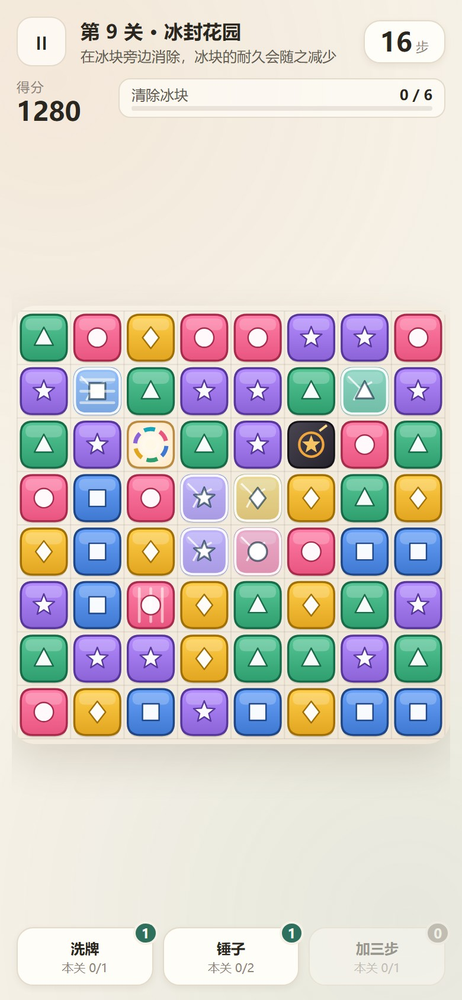
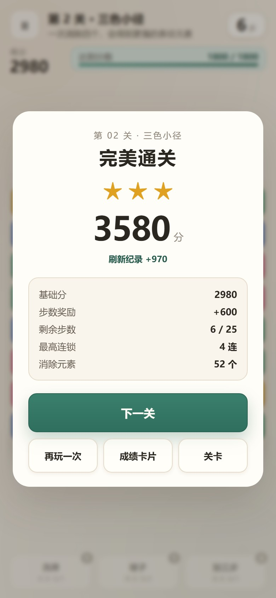
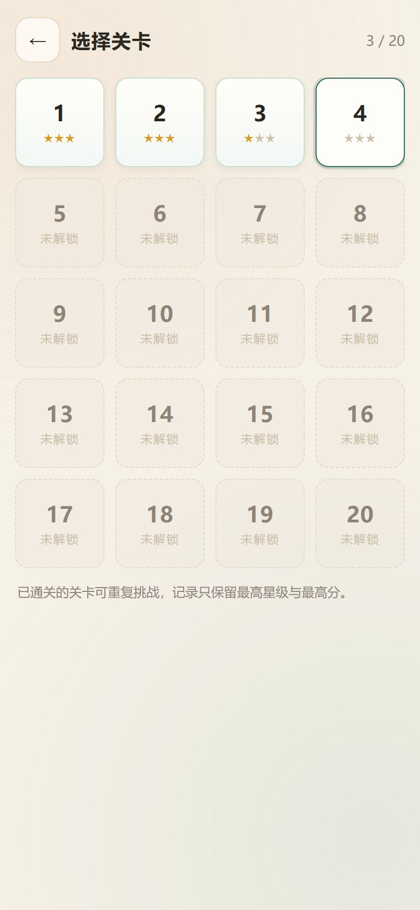

# 三消小径

**[▶ 在线试玩](https://hanser-qwq.github.io/3match-game/)**

**一个纯前端、零依赖、可离线的关卡制三消小游戏。**

A zero-dependency, offline-capable match-3 puzzle built with vanilla JavaScript and Canvas 2D.

没有后端、没有账号、没有广告：打开网页就能玩，进度存在本机，断网也能继续。

<p align="center">
  
  
  
  
</p>

<p align="center"><sub>首页 · 对局 · 结算 · 关卡</sub></p>

---

## 玩法

| 规则 | 说明 |
| --- | --- |
| 核心操作 | 交换相邻两个元素，三个及以上同色连成一线即消除，上方元素下落补位 |
| 交换规则 | **任何相邻交换都会真正执行并消耗一步**；没有形成消除时，这一步没有收益 |
| 连锁 | 第 s 段倍率 `min(1 + 0.5 × (s − 1), 3)`，即 1 → 1.5 → 2 → 2.5 → 3（封顶） |
| 特殊元素 | 四连 → **条纹**（清整行或整列）；五连 → **彩虹**（清掉同色）；L 形或 T 形（横竖交叉）→ **炸弹**（横纵坐标和 ≤ 2 的菱形，13 格） |
| 炸弹 | 没有颜色、不参与匹配，**与任意相邻元素交换即引爆**菱形范围（13 格），带冲击波与震屏；被条纹或彩虹波及时也会连锁引爆 |
| 特殊组合 | 彩虹 + 条纹把全部同色转成条纹再引爆；条纹 + 条纹清整行整列；彩虹 + 炸弹清 5×5 |
| 障碍 | 冰块不能交换、不能直接消除，靠相邻位置的消除来削减耐久 |
| 目标 | 分数、收集指定元素、清除冰块，以及三者的组合 |
| 结算 | 达成目标后**不会强制结束**：可以继续消除把分数做高，也可以随时结算并领取剩余步数奖励 |
| 道具 | 洗牌、锤子、加三步；每关三种道具共用 2 次使用机会 |
| 关卡 | 20 关，逐关解锁，按分数评 1–3 星，只记录更高星级与更高分 |
| 关卡开始 | 进入时弹窗显示通关目标、步数与 1/2/3 星分数线；EX 关额外显示追加机制 |
| 成就 | 13 项本地成就，首页可查看；老存档按历史进度补发可回溯成就，结算解锁时弹窗提示 |

计分：每个元素 10 分 × 连锁倍率，触发特殊元素额外 50 分；通关时每剩余一步 100 分。

## 体验与工程

| 关注点 | 做法 |
| --- | --- |
| 色觉友好 | 六种元素同时用**颜色 + 形状**编码（圆/方/三角/菱/星/六边），形状默认绘制；冰块之上也重绘形状 |
| 操作方式 | 触屏点选或拖动、鼠标、键盘（方向键移动光标，空格选择与交换，Esc 暂停） |
| 本地存档 | 每次成功操作后写入 `localStorage`，支持断点续玩与旧版本存档迁移 |
| 离线可玩 | Service Worker 缓存优先，访问过一次后断网也能进入已解锁关卡，可添加到主屏 |
| 降级策略 | 连续低于 45 FPS 自动减少粒子与动画，判定结果完全不变 |
| 失败可见 | 存档写不进去、关卡数据损坏都会明确提示并降级，不静默失败 |

## 直接玩

- **单文件版**：双击 `dist/三消小径.html`。全部代码、样式、关卡都内联在这一个文件里，`file://` 下直接可运行。
- **完整版**：需要本地服务器（因为浏览器禁止 `file://` 加载 ES 模块）。

```bash
python -m http.server 8080
# 打开 http://localhost:8080/
```

也可以直接把仓库部署到任意静态托管（GitHub Pages / Cloudflare Pages），根目录的 `index.html` 即为入口。

## 技术实现

- **原生 ES 模块**，四层架构（表现 / 应用 / 领域 / 基础设施）+ 单向依赖 + 事件总线，不引入任何框架与运行时库
- **领域层零浏览器依赖**：棋盘、匹配、连锁结算、死局检测、计分都是纯函数或纯数据结构，可脱离 DOM 独立测试
- **Canvas 2D 全程序化绘制**：元素、特殊效果、冰块、粒子、成绩卡片全部由代码绘制，游戏本体不含任何位图素材（仓库里的图片只有本文档的截图）
- **Web Audio 实时合成音效**：没有音频文件，音高随连锁段数升高
- **结算输出的是序列而不是最终棋盘**：每段消除的中间态都保留，动画按序列逐帧播放，测试也能断言任意中间状态
- **可解性保证**：生成棋盘时逐格避开三连，一次成型；重排与洗牌共用同一套重试 + 强制构造策略，不会出现无解棋盘
- **单文件版由自写打包器生成**（`tools/build-standalone.mjs`），不依赖 webpack / vite

## 目录结构

```
index.html                  入口（六个场景的 DOM 骨架）
css/style.css               全部样式
js/core/                    常量、事件总线、可注入种子的随机源
js/domain/                  棋盘、匹配、连锁、死局、计分、目标、道具规则
js/application/             游戏控制器、会话状态机、新手引导
js/infrastructure/          关卡加载、存档、音频、离线缓存
js/presentation/            Canvas 渲染、输入、无障碍、场景、成绩卡片
levels/level-01..20.json    关卡数据（唯一数据源）
dist/三消小径.html          单文件构建产物
tests/domain.test.mjs       领域层单元测试
tools/                      关卡生成、平衡模拟与单文件打包脚本
assets/screenshots/         README 截图
```

## 测试

```bash
node --test tests/domain.test.mjs
```

18 项用例，覆盖三连识别、冰块打断连线、虚拟交换判定、特殊元素生成与落点、逐段计分与倍率封顶、星级阈值、连锁倍率递增、下落与补位、冰块耐久、死局识别、200 个随机种子的生成可解性等。

## 浏览器支持

在 Chrome / Edge（Chromium 内核）上完整验证；代码未使用非标准 API，Firefox 与 Safari 预期可用，但未逐台走查。

Service Worker 需要 HTTPS 或 localhost；`file://` 下会自动改用内置关卡副本，双击单文件版照样能玩。


## 许可

课程作业，代码与美术、音效均为自制。欢迎阅读、学习与 fork；如需转载或商用请先联系作者。
